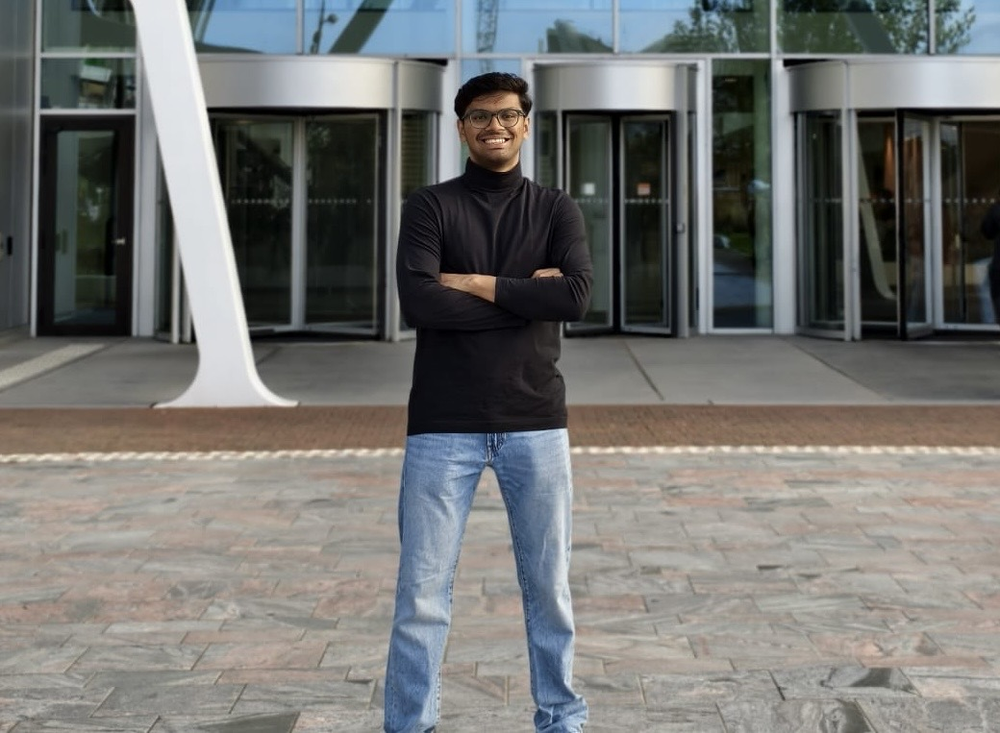

# Coke & Code

### Four Leiden University master’s students, one shared love of building.

We’re a team of four master’s students at **Leiden University** who enjoy turning ideas into working projects. We collaborate across AI, data science and software development, learning together as we build.

## Meet the team

<table>
  <tr>
    <td align="center" width="50%">
       
      <strong>Sunil</strong> MSc Artificial Intelligence
    </td>
    <td align="center" width="50%">
       
      <strong>Smriti</strong> MSc Artificial Intelligence
    </td>
  </tr>
  <tr>
    <td align="center" width="50%">
      <em>Photo coming soon</em>  
      <strong>Joshua</strong> MSc Artificial Intelligence
    </td>
    <td align="center" width="50%">
      <em>Photo coming soon</em>  
      <strong>Oindrilla</strong> MSc Data Science
    </td>
  </tr>
</table>

## What we build

From early experiments to complete applications, we work together on projects that use technology to solve real problems.
