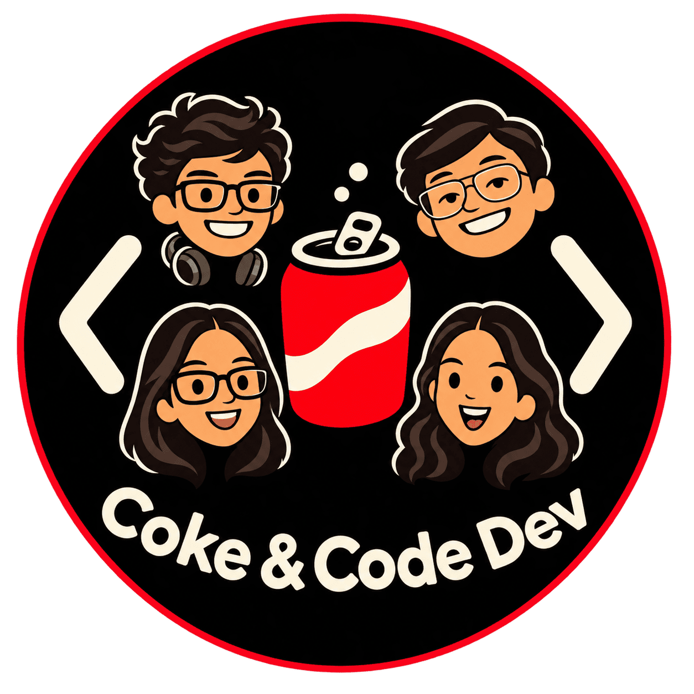

  

  
  
  

<h3 align="center">Four Leiden University master’s students, one shared love of building. 🥤</h3>

  We’re <b>Coke &amp; Code Dev</b>. We turn ideas into working projects across
  <b>AI</b>, <b>data science</b> and <b>software</b>, 
  and we learn something new with every build.

  

<h2 align="center">🥤 Meet the crew</h2>

Tap a card to visit someone’s GitHub.

<table align="center">
  <tr>
    <td align="center" valign="top" width="50%">
      
      <h3>Sunil Parameswaran</h3>
      🤖 MSc Artificial Intelligence
      
<i>Building with LLMs, AI agents and machine learning</i>

      

        
        
      

    </td>
    <td align="center" valign="top" width="50%">
      
      <h3>Smriti Sridhar</h3>
      🤖 MSc Artificial Intelligence
      
<i>Practical, scalable AI systems and security-minded backends</i>

      

        
        
      

    </td>
  </tr>
  <tr>
    <td align="center" valign="top" width="50%">
      
      <h3>Joshua Varghese Thomji</h3>
      🤖 MSc Artificial Intelligence
      
<i>AI developer and data scientist</i>

      

        
        
      

    </td>
    <td align="center" valign="top" width="50%">
      
      <h3>Oindrilla Banerjee</h3>
      📊 MSc Data Science
      
<i>Data science, machine learning and AI</i>

      

        
        
      

    </td>
  </tr>
</table>

  

<h2 align="center">🛠️ Tools we reach for</h2>

<!-- Everything between the TOOLS markers is rewritten daily by .github/workflows/update-tools.yml -->
<!-- TOOLS:START -->

  

<!-- TOOLS:END -->

  

  

  <code>&lt;/&gt;</code> Crafted in Leiden, one fizzy commit at a time. <code>🥤</code>

