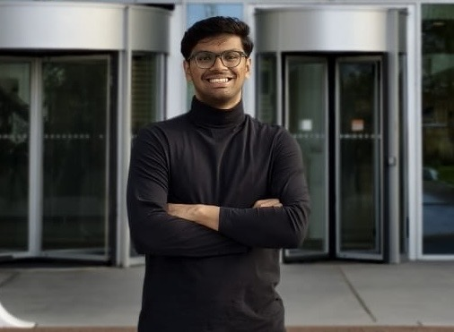
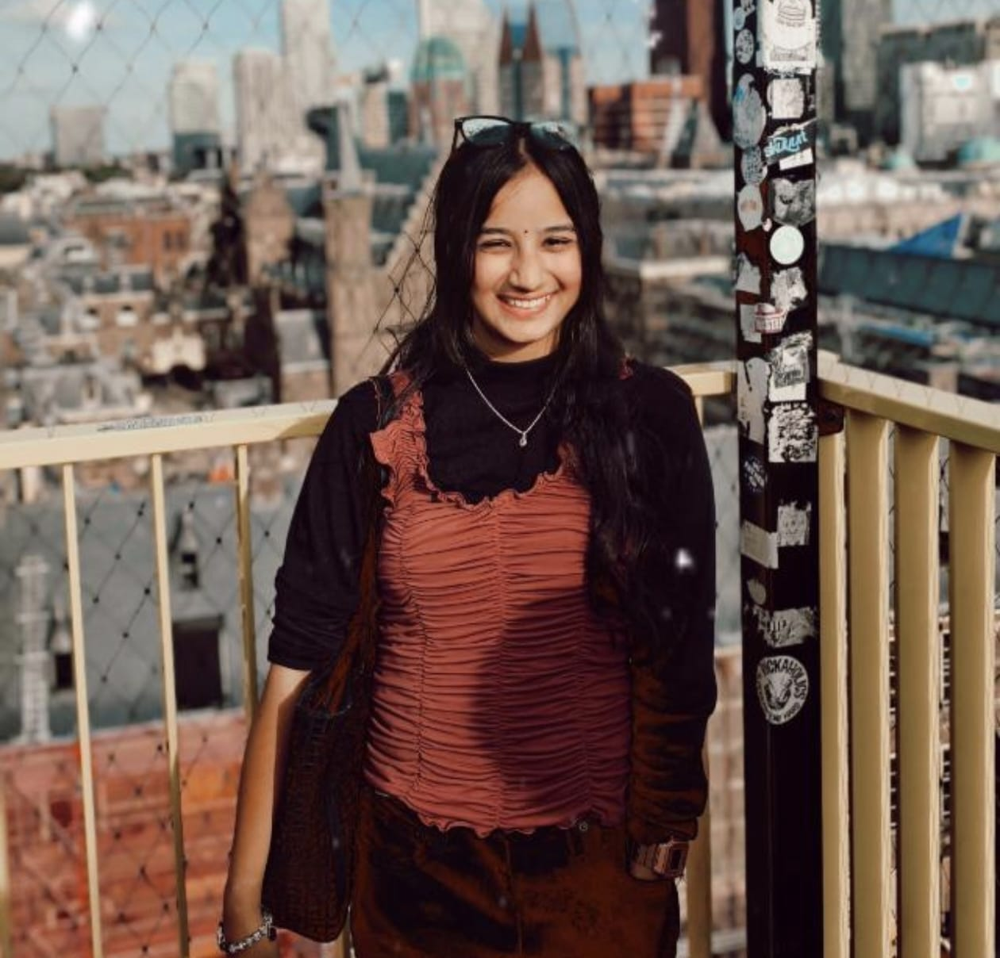

  

  
  
  

<h3 align="center">Four Leiden University master’s students, one shared love of building. 🥤</h3>

  We’re <b>Coke &amp; Code Dev</b>. We turn ideas into working projects, collaborating across
  <b>AI</b>, <b>data science</b> and <b>software development</b>,
  and learning together with every build.

---

## 👋 Meet the team

<table align="center">
  <tr>
    <td align="center" width="50%">
       
      <h3>Sunil</h3>
      🤖 MSc Artificial Intelligence
    </td>
    <td align="center" width="50%">
       
      <h3>Smriti</h3>
      🤖 MSc Artificial Intelligence
    </td>
  </tr>
  <tr>
    <td align="center" width="50%">
       
      <h3>Joshua</h3>
      🤖 MSc Artificial Intelligence
    </td>
    <td align="center" width="50%">
       
      <h3>Oindrilla</h3>
      📊 MSc Data Science
    </td>
  </tr>
</table>

---

## 🛠️ What we build

From early experiments to complete applications, we work together on projects that use technology to solve real problems.

<table>
  <tr>
    <td width="33%" valign="top">
      <h4>🧠 AI &amp; ML</h4>
      Models, experiments and intelligent systems, from research prototypes to usable tools.
    </td>
    <td width="33%" valign="top">
      <h4>📈 Data Science</h4>
      Turning messy data into clear insights, analyses and visualisations.
    </td>
    <td width="33%" valign="top">
      <h4>💻 Software</h4>
      Full applications with clean code, built and shipped as a team.
    </td>
  </tr>
</table>

<!--
## 🚀 Featured projects
| Project | What it does | Stack |
|---|---|---|
| [project-name](https://github.com/Coke-and-Code-Dev/project-name) | One-line description | Python · PyTorch |
-->

---

  <code>&lt;/&gt;</code> Crafted in Leiden, one fizzy commit at a time. <code>🥤</code>

